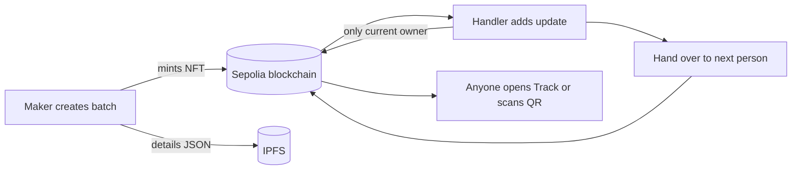

<div align="center">

#  Craft-Chain

### The story behind every handmade batch.

Every handmade batch becomes a digital tag on the blockchain.
Each person who touches it adds a stop to its journey, and anyone can scan a QR code to see it. No wallet needed.

<br>

[](https://craft-chain-iota.vercel.app/)
[](https://sepolia.etherscan.io/address/0xeBAb6C19bC410DbD0a44Dba3D6A731862105Cf83)


</div>

---

## ✨ Why this exists

When you buy a handwoven saree or a block-printed scarf, a paper tag says "handmade". There is no way to check it.
Craft-Chain makes that claim checkable:

- 🧶 **The maker** creates a batch. It becomes an ERC-721 token with its name, origin, material and date.
- 🚚 **Everyone after** (dyer, packer, transporter, shop) adds an update as the batch passes through their hands.
- 🔍 **The buyer** scans the QR code and sees the whole journey. Nothing can be edited or deleted afterwards.

<!-- Add a screenshot here:
<p align="center"></p>
-->

## 🧭 How it works



| Tab | What it does |
| --- | --- |
| **Make** | Creates a new batch (mints the NFT) |
| **Update** | Adds a step: Processed, Moved, Quality checked, Received by retailer |
| **Hand over** | Passes the batch to the next person |
| **Track** | Lists every batch. Click one to see its hang tag and journey |

## 🔐 Who is allowed to do what?

The smart contract checks it, not the website:

```solidity
require(ownerOf(tokenId) == msg.sender, "Not batch owner");
```

Only the wallet that currently holds a batch can add updates to it. Switch MetaMask accounts and the contract rejects you.

## 🗂️ Where the data lives

| Data | Where | Why |
| --- | --- | --- |
| Who owns the batch | Blockchain | Can't be faked |
| Each update (type, time, who, fingerprint) | Blockchain events | Permanent history |
| Names, descriptions, notes | IPFS | Cheap, and tied to the blockchain by a hash |

The website has no database. It rebuilds every batch's story from blockchain events.

## 🛠️ Built with

- **Contract:** Solidity 0.8.28, OpenZeppelin v5 (ERC721, ERC721URIStorage, AccessControl), Hardhat
- **Frontend:** Next.js 14, ethers v6, MetaMask, qrcode.react
- **Storage:** IPFS through Pinata (the key stays on the server)
- **Network:** Sepolia testnet, hosted on Vercel

## 📁 Project structure

```
craft-chain/
├── contracts/            # Hardhat project
│   ├── contracts/        # CraftBatch721.sol
│   ├── test/             # unit tests
│   └── scripts/          # deploy.js
└── frontend/             # Next.js app
    └── src/app/          # pages, BatchView, /api/pin
```

## 🚀 Run it yourself

**1. Contract**

```bash
cd contracts
npm install
npx hardhat test
npx hardhat run scripts/deploy.js --network sepolia
```

Create `contracts/.env`:

```
SEPOLIA_RPC_URL=<your Alchemy or Infura URL>
PRIVATE_KEY=<test wallet key, never your real one>
```

**2. Frontend**

```bash
cd frontend
npm install
npm run dev
```

Copy `contracts/deployed.json` to `frontend/src/contract.json`, then create `frontend/.env.local`:

```
PINATA_JWT=<your Pinata JWT>
NEXT_PUBLIC_IPFS_GATEWAY=<your gateway URL>
```

Open http://localhost:3000, connect MetaMask on Sepolia, and create a batch.

## 🧩 Explore the code

**Architecture diagram:** [GitDiagram](https://gitdiagram.com/theanamsaqib/craft-chain)

## 📸 Screenshots

<!-- Add 2–3 screenshots: Make tab, Track list, hang tag with journey -->

---

<div align="center">

Built by [Annie](https://github.com/theanamsaqib) as a blockchain course project.

**Read the whole codebase as text:** [GitIngest](https://gitingest.com/theanamsaqib/craft-chain)

</div>
